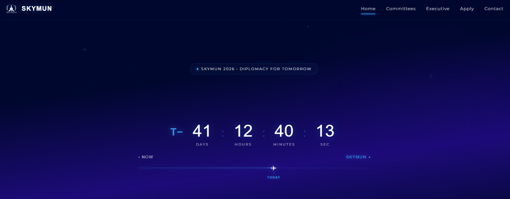
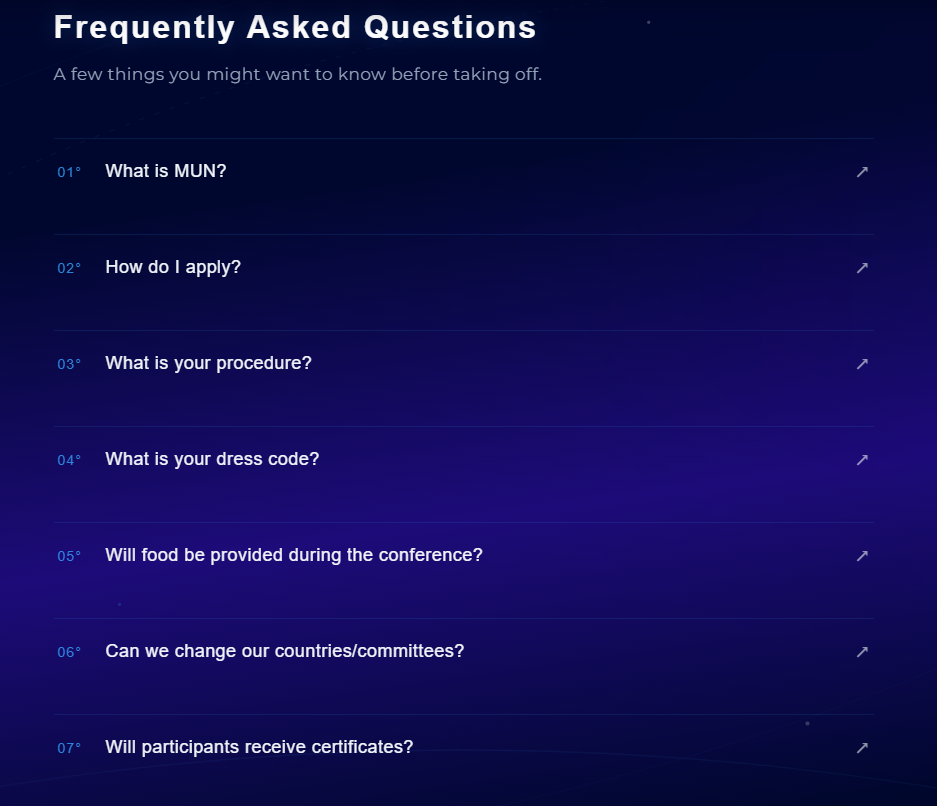
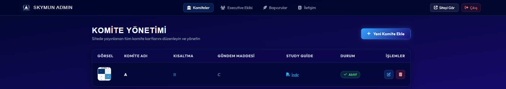
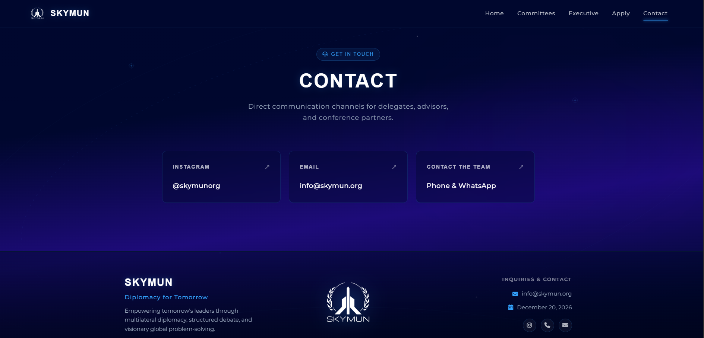

# SKYMUN — Aerospace-Themed Conference Platform & Custom CMS

[English](#english) | [Türkçe](#türkçe)

---

<a name="english"></a>
## 🌐 English

> **A dynamic, aerospace-themed conference platform with a custom PHP/MySQL content management system that allows organizers to manage committees, executive teams, application packages, contact channels, and conference content without manually editing the website's code.**

[](https://polypsense.com/skymun/)
[](https://www.php.net/)
[](https://www.mysql.com/)
[](LICENSE)

🌐 **Active Temporary Preview:**  
The platform is currently live and actively hosted for preliminary preview at:  
👉 **[https://polypsense.com/skymun/](https://polypsense.com/skymun/)**  
*(Temporarily hosted here prior to final transfer to the primary conference domain).*

---

### ⚠️ Important Notice & Disclaimer
**This repository is published strictly as a showcase, portfolio demonstration, and educational reference.**  
The codebase was developed as a preliminary preparatory and conceptual platform for our **SkyMUN** event. Therefore, **we kindly ask you not to duplicate, re-host, or use this project, its branding, or assets directly for other conferences as-is**. You are welcome to inspect, study, and learn from its architectural patterns, CMS design, and frontend animations.

---

### 📸 Visual Showcase

#### 1. Hero & Aerospace Mission Telemetry Clock
Live real-time mission clock with T− countdown telemetry, destination lock (MUC corridor), and dynamically progressing flight trajectory line with aircraft beacon.


#### 2. Minimalist Typographic FAQ Accordion
Aerospace telemetry-styled `01°` indexed accordion drawers with smooth cubic-bezier transitions.


#### 3. Custom Administration CMS Console
Organizers can manage committees, executive members, study guides, pricing, and contact channels in real time without modifying source code.


#### 4. Contact & Aerospace Footer Portal
Glassmorphic, privacy-conscious communication interface and footer architecture.


---

### 🚀 Key Features

#### 🎛️ Custom CMS & Admin Capabilities (Zero Code Modification Required)
- **Committee Management:** Add, edit, sort, and publish committees; upload cover banners and Study Guide PDFs with automated storage handling.
- **Executive Board Management:** Add executive secretariat profiles, assign titles, upload portrait photos, and manage display order.
- **Applications Management:** Configure registration tiers (Individual Delegate, School Delegations, Staff), set dynamic fees, and manage registration links.
- **Communication Channels:** Manage social handles, official inquiries, and support desks without editing template files.

#### 🌌 Frontend Experience
- **Aerospace Telemetry Clock (T− Mission Clock):** Millisecond-accurate live countdown, scheduled waypoint coordinates, and real-time flight distance remaining.
- **Smooth Trajectory Jetstream:** An aircraft beacon advancing smoothly across a glowing progress track toward the conference date.
- **Full Responsive Design:** Tailored glassmorphism interfaces optimized for desktop, tablet, and mobile screens.

---

### ⚙️ Security & Environment Configuration

> 🔒 **Security Notice:**  
> This project relies on environment variables for sensitive settings. **Do not hardcode administrator credentials, database passwords, or private channels into the codebase.**  
> Default values in `config.php` are provided strictly as fallbacks for isolated local development sandboxes. For any public or production deployment, administrators **must define their own strong credentials**.

#### Configuring via `.env` (Recommended)
Copy the example configuration file and set your secure credentials:
```bash
cp .env.example .env
```
Inside `.env`:
```env
# Database Credentials
DB_HOST=localhost
DB_PORT=3306
DB_NAME=skymun
DB_USER=your_db_username
DB_PASS=your_secure_db_password

# Administrator Authentication (Required for Production!)
ADMIN_USER=your_custom_admin_username
ADMIN_PASS=your_strong_custom_password

# Conference Configuration
SITE_NAME=SKYMUN
SITE_MOTTO=Diplomacy for Tomorrow
SITE_URL=http://localhost
CONFERENCE_DATE=2026-12-20 09:00:00
CONTACT_EMAIL=contact@yourdomain.org
```

---

### 🛠️ Quick Start & Installation

The platform includes a **Zero-Config Database Engine**. On first launch in a local environment (XAMPP, Laragon, WAMP, Docker, etc.), it connects to MySQL, automatically creates the database if it doesn't exist, establishes all required tables, and seeds initial starter records.

#### 1. Clone the Repository
```bash
git clone https://github.com/eymencapoglu/skymun.git
cd skymun
```

#### 2. Set Up Environment Variables
```bash
cp .env.example .env
# Edit .env with your preferred database and admin credentials
```

#### 3. Run on Local Web Server
Place the files in your web server root (e.g. `C:/xampp/htdocs/skymun`) or launch PHP's built-in development server:
```bash
php -S localhost:8000
```

#### 4. Automatic Database Creation
Open `http://localhost:8000` in your browser. `config.php` automatically initializes the schema and default demonstration content on first visit.  
*(Optional manual schema import: `mysql -u root -p < schema.sql`)*

#### 5. Accessing the Administration Panel
Navigate to:
```
http://localhost:8000/admin/
```
Log in using the administrator credentials configured in your `.env` or `config.php`.

---

<br>

---

<a name="türkçe"></a>
## 🇹🇷 Türkçe

> **Organizatörlerin web sitesinin kaynak koduna manuel olarak müdahale etmesine gerek kalmadan komiteleri, yönetim ekiplerini, başvuru paketlerini, iletişim kanallarını ve konferans içeriklerini tek bir panelden yönetmesine olanak tanıyan, özel PHP/MySQL içerik yönetim sistemine (CMS) sahip dinamik, havacılık ve uzay temalı konferans yönetim platformu.**

[](https://polypsense.com/skymun/)
[](https://www.php.net/)
[](https://www.mysql.com/)
[](LICENSE)

🌐 **Canlı Geçici Önizleme Adresi:**  
Platform, ana konferans alan adına taşınmadan önce geçici olarak aşağıdaki adreste aktif biçimde yayındadır:  
👉 **[https://polypsense.com/skymun/](https://polypsense.com/skymun/)**

---

### ⚠️ Önemli Uyarı & Yasal Bildirim
**Bu depo, yalnızca portfolyo, örnek çalışma (showcase) ve eğitim amaçlı olarak kamuya açılmıştır.**  
Buradaki kodlar, **SkyMUN** isimli etkinliğimiz için ön hazırlık ve konsept çalışması olarak geliştirildiğinden dolayı, **bu projeyi, görsel kimliğini veya içeriğini başka etkinlikler için birebir kopyalamamanızı, klonlayarak doğrudan yayınlamamanızı rica ederiz.** Kod yapısını mimari inceleme, CMS tasarımı ve arayüz animasyonları için referans alabilirsiniz.

---

### 📸 Ekran Görüntüleri

#### 1. Havacılık Telemetri Sayacı & Ana Sayfa
Canlı T− görev geri sayım sayacı, hedef koordinat kilidi (Münih uçuş koridoru) ve konferans tarihine doğru ilerleyen uçak ikonu.


#### 2. Minimalist Tipografik S.S.S. (FAQ)
Havacılık derece formatında (`01°–07°`) indekslenmiş akıcı açılır kapanır akordeon paneller.


#### 3. Özel Yönetim Paneli (CMS Dashboard)
Organizatörlerin kod düzenlemeye ihtiyaç duymadan komiteleri, Study Guide PDF dosyalarını ve başvuru paketlerini yönetebildiği panel.


#### 4. İletişim Portalı & Altbilgi (Footer)
Gizlilik odaklı, cam efektli (glassmorphic) iletişim kanalları ve havacılık tasarım sistemi.


---

### 🚀 Temel Özellikler

#### 🎛️ Özel İçerik Yönetim Sistemi (CMS) Yetenekleri
- **Komite Yönetimi:** Yeni komite ekleme, silme, sıralama; komite kapak görseli ve Study Guide PDF dosyası yükleme.
- **Yönetim Kurulu Yönetimi:** Ekip üyelerini düzenleme, unvan tanımlama ve fotoğraf yükleme.
- **Başvuru Yönetimi:** Başvuru kategorileri (Bireysel Delege, Delegasyon vb.), katılım ücretleri ve kayıt linklerini dinamik yönetme.
- **Kanal & İletişim Ayarları:** İletişim kanallarını kod değiştirmeden açıp kapatma veya güncelleme.

---

### ⚙️ Güvenlik ve Yapılandırma

> 🔒 **Güvenlik Bildirimi:**  
> Bu proje hassas ayarlar için ortam değişkenlerini (Environment Variables) kullanır. **Yönetici şifrelerini, veritabanı parolalarını veya özel iletişim bilgilerini kaynak koda yazmayınız.**  
> `config.php` içerisindeki varsayılan değerler sadece yerel sandbox/demo geliştirme amaçlıdır. Canlıya alırken yöneticinin **kendi güçlü şifre ve kullanıcı adını belirlemesi zorunludur**.

#### `.env` ile Yapılandırma (Önerilen)
Örnek dosyayı kopyalayın ve kendi güvenli bilgilerinizi yazın:
```bash
cp .env.example .env
```
`.env` içeriği:
```env
# Veritabanı Bilgileri
DB_HOST=localhost
DB_PORT=3306
DB_NAME=skymun
DB_USER=veritabani_kullanicisi
DB_PASS=guclu_veritabani_sifresi

# Yönetici Giriş Bilgileri (Canlı Kurulumda Zorunludur!)
ADMIN_USER=kendi_admin_kullanici_adiniz
ADMIN_PASS=kendi_guclu_admin_sifreniz

# Konferans Ayarları
SITE_NAME=SKYMUN
SITE_MOTTO=Diplomacy for Tomorrow
SITE_URL=http://localhost
CONFERENCE_DATE=2026-12-20 09:00:00
CONTACT_EMAIL=info@seninalanadin.org
```

---

### 🛠️ Kurulum Adımları

Projede **Zero-Config (Sıfır Yapılandırma)** veritabanı motoru bulunmaktadır. Yerel ortamda (XAMPP, Laragon, WAMP vb.) ilk çalıştırmada veritabanını, tabloları ve örnek başlangıç verilerini otomatik kurar.

#### 1. Depoyu Klonlayın
```bash
git clone https://github.com/eymencapoglu/skymun.git
cd skymun
```

#### 2. `.env` Dosyanızı Oluşturun
```bash
cp .env.example .env
# .env dosyasını açıp kendi şifre ve ayarlarınızı tanımlayın
```

#### 3. Sunucuyu Başlatın
Dosyaları yerel sunucunuzun kök dizinine taşıyın veya PHP dahili sunucusu ile çalıştırın:
```bash
php -S localhost:8000
```

#### 4. Yönetim Paneline Erişim
Tarayıcınızda yönetim paneline gidin:
```
http://localhost:8000/admin/
```
Giriş için `.env` dosyanızda belirlediğiniz yönetici kullanıcı adı ve şifresini kullanın.

---

## 📂 Dizin Yapısı / Directory Structure

```
skymun/
├── admin/                    # Yönetim Paneli / Administration CMS
│   ├── index.php             # Admin login
│   ├── nav.php               # Admin navigation
│   ├── committees.php        # Committee list & actions
│   ├── committee-edit.php    # Committee editor & PDF/image upload
│   ├── executives.php        # Executive team list
│   ├── executive-edit.php    # Executive editor
│   ├── applications.php      # Application tiers
│   ├── application-edit.php  # Application editor
│   ├── contact.php           # Channels settings
│   └── logout.php            # Logout handler
├── screenshots/              # Ekran Görüntüleri / Visual Showcase
│   ├── 01-hero-countdown.png # Hero section & telemetry clock
│   ├── 02-faq-section.png    # Typographic FAQ accordion
│   ├── 03-admin-cms.png      # Custom Admin CMS interface
│   └── 04-contact-footer.png # Contact portal & footer architecture
├── uploads/                  # Yüklemeler / User uploads (Protected)
│   ├── .gitkeep              # Git tracking placeholder
│   └── index.php             # Directory traversal shield
├── apply.php                 # Registration / Application page
├── committee.php             # Single committee view
├── committees.php            # Committees showcase
├── config.php                # Core configuration, .env parser & PDO database engine
├── contact.php               # Contact channels page
├── executive.php             # Executive board showcase
├── footer.php                # Site footer component
├── header.php                # Site header & background scripts
├── index.php                 # Landing page (HUD telemetry clock & FAQ)
├── navbar.php                # Navigation bar
├── schema.sql                # Manual database schema & starter seeds
├── logo-transparent.png      # Official SKYMUN transparent emblem
├── .env.example              # Environment variables template
├── .gitignore                # Git exclusions
├── LICENSE                   # MIT License
└── README.md                 # Project documentation
```

---

## 📄 Lisans / License

This project is licensed under the [MIT License](LICENSE).
